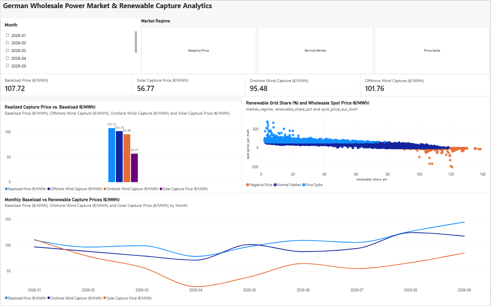

# German Wholesale Power Market & Renewable Capture Analytics

End-to-end Python, SQL, and Power BI pipeline analyzing EPEX SPOT wholesale electricity prices, renewable cannibalization, and negative price drivers across **6,551 hourly records** in Germany for periods of **01.01.26 - 31.09.26**.

## Capture Price & Cannibalization Summary

| Technology / Benchmark | Realized Price (€/MWh) | Capture Rate | Economic Driver |
| :--- | :---: | :---: | :--- |
| **Baseload (Market Avg)** | **€107.72** | **100.0%** | 24/7 simple average across all 6,551 hourly spot prices |
| **Offshore Wind** | **€101.76** | **94.5%** | Steady marine generation captures peak and evening demand |
| **Onshore Wind** | **€95.48** | **88.6%** | Strong winter and nighttime output aligns with grid load |
| **Solar (Photovoltaics)** | **€56.77** | **52.7%** | **Cannibalization effect:** midday solar surges compress spot prices |

* **Negative Price Drivers (452 Hours):** Sub-zero spot prices (averaging **-€17.19/MWh**) occurred when combined renewable generation exceeded national demand (**108.5% average renewable share**, **-3,789 MW residual load**).
* **Price Spikes (1,375 Hours):** Low renewable output (**26.0% share**) forced conventional plants to cover **39,022 MW of residual load**, driving average prices to **€187.69/MWh**.

## Tech Stack & Pipeline
* **Python (`Pandas`):** Cleaned raw SMARD exports, parsed timestamps, and engineered hourly renewable penetration and volatility metrics.
* **SQL (`SQLite`):** Executed multi-table `INNER JOIN` queries unifying Day-Ahead Spot Prices, Generation, and Consumption datasets.
* **Power BI (`DAX`):** Built dynamic generation-weighted Capture Price measures (`SUMX` / `DIVIDE`) with interactive `Month` and `Market Regime` slicers.